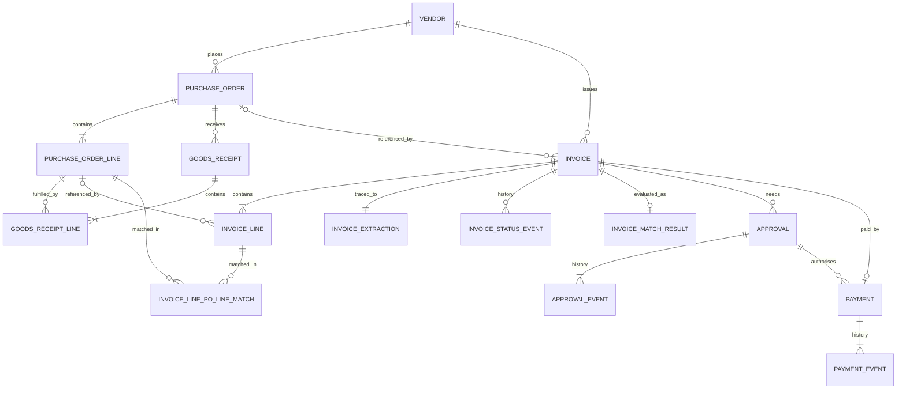

# ER diagram and cardinalities

| Relationship | Cardinality | Optional? | Notes |
|---|---|---|---|
| Vendor - PurchaseOrder | 1:N | PO needs a vendor | closed vendors keep historical POs |
| Vendor - Invoice | 1:N | invoice needs a vendor | closed-vendor defect uses a valid FK |
| PurchaseOrder - PurchaseOrderLine | 1:N (1-8) | at least 1 line | |
| PurchaseOrder - GoodsReceipt | 1:N | a PO may have 0 receipts | missing-receipt scenario |
| GoodsReceipt - GoodsReceiptLine | 1:N | at least 1 line | |
| PurchaseOrderLine - GoodsReceiptLine | 1:N | 0..N | partial receipts split across GRNs |
| PurchaseOrder - Invoice | 1:N | invoice.po_id optional | non-PO invoices exist |
| Invoice - InvoiceLine | 1:N | at least 1 line | |
| Invoice - InvoiceExtraction | 1:1 | required for every ingested invoice | stores document name, SHA-256, extracted fields and extraction date |
| InvoiceLine - PurchaseOrderLine | N:M via invoice_line_po_line_match | 0..N | engine-derived bridge |
| Invoice - Approval | 1:N (L1, L2) | only eligible invoices | |
| Invoice - Payment | 1:0..1 | only approved, unblocked | |
| Invoice / Approval / Payment - event history | 1:N | event tables are defined for these records | state changes are recorded as distinct event rows |

Effective dates: vendor.effective_from / effective_to. Lifecycle states: see section 11 of
the data dictionary.
